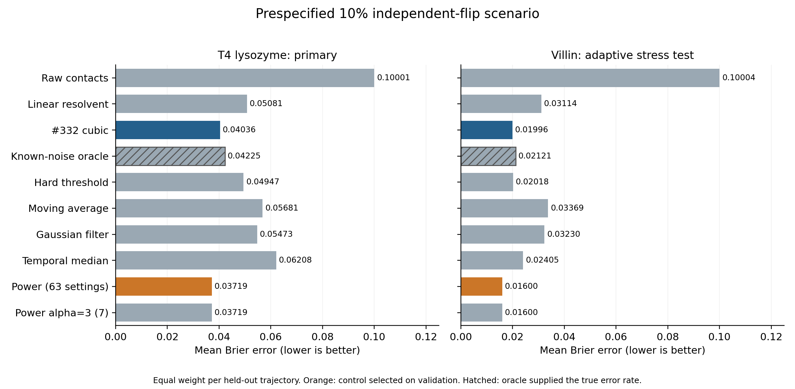

# Negative result: expected-median smoothing of protein contacts

Part of [Rada’s Bioinformatics Portfolio](../../README.md). Run this project’s
commands from `projects/protein-contact-benchmark/`.

**Status: the predefined practical-success test failed.** This benchmark tested
whether an expected-median construction used in OpenAI/math catalogue family
**#332** improves recovery of artificially corrupted protein-contact trajectories.
On held-out T4 lysozyme simulations, it did not beat the stronger prespecified
controls. A separate villin stress test also favored those controls.

This repository preserves the negative result, frozen rules, implementation,
numerical outputs, source provenance, and five AI technical review reports.
It does **not** show that the mathematical theorem is false.

## Results

Brier error measures squared error against uncorrupted simulated contacts;
lower is better. These are the declared 10% independent-flip, 8 Å scenarios.

| Experiment | Cubic Brier error | Selected control Brier error | Cubic excess error |
|---|---:|---:|---:|
| T4 lysozyme — primary | 0.040363 | 0.037191 | **8.53% worse** |
| Villin — separate adaptive stress test | 0.019960 | 0.015995 | **24.79% worse** |

The selected control in both cases was power sharpening, chosen on validation
data only. A matched-budget comparison, with seven settings for each method,
gave the same primary scores and failed decision. T4 failed all four required
conditions: at least 2% mean error reduction, improvement on every test run,
and acceptable rare- and brief-contact recall losses on every run.

The cubic improved over the independently tuned basic linear smoother by
20.55% on T4 and 35.90% on villin. That improvement was insufficient against
the stronger controls. Across all 16 prespecified dataset/scenario combinations,
the selected control had lower error in 15; the cubic's one tiny secondary
advantage did not change the primary conclusion. **Ubiquitin was excluded by
the temporal-provenance gate; it has no denoising result.**



## What was tested

Each protein trajectory becomes a binary table: rows are simulation frames,
columns are residue pairs, and a 1 means a pair is in contact. We add known
artificial corruption and ask how accurately each method recovers the original
table. The reference is a simulation, not experimental biological truth.

The tested method computes

$$H=[I+t(I-A)]^{-1}Z,\qquad Y=3H^2-2H^3,$$

where the powers are entrywise, $Z$ is the corrupted contact table, and $A$ is
a lazy reflecting random walk along time. The cubic is the expected median of
three independent binary endpoint labels. Its output is contact scores, not a
reconstructed three-dimensional protein structure.

The [October 5 mathematical manuscript](https://github.com/openai/math/blob/adc7f1241b42e322a6451854ab7e4b4c146bf78a/preprints/Metric-Markov-Cotype-Two-of-l1-October-5-2026/l1-markov-cotype.pdf)
uses this construction in a metric Markov-cotype argument. The cubic construction
already appears in [earlier nonlinear cut-smoothing work](https://arxiv.org/abs/2609.08749v2).
The released inequality does not promise lower Brier error. **#332 identifies
a catalogue family, not a GitHub issue or software version.** We make no claim
that this is a new cubic algorithm or a novel protein-analysis method.

## Read or reproduce

- [Full frozen research report](benchmark_report.pdf), [plain-text results](RESULTS.txt), and [references](REFERENCES.txt).
- [Public-checkout reproduction instructions](REPRODUCING.md).
- [Frozen rules](protocol/FROZEN_RULES.txt), [authoritative protocol 1.1](protocol/protocol_v1.1.json), and [pre-outcome amendments](protocol/AMENDMENTS.txt).
- [All method/scenario metrics](metrics.csv), [structured summary](summary.json), and complete numerical outputs in [results](results).
- [Data sources and acquisition requirements](DATA_SOURCES.md).
- [Review scope and limitations](reviews/README.md), [responses to findings](REVIEW_RESPONSE.txt), and [release changes](RELEASE_NOTES.md).

Quick offline checks, using Python 3.12:

```bash
python -m venv .venv
source .venv/bin/activate
python -m pip install -r requirements-benchmark.txt
python scripts/check_release.py
```

These checks verify the release files, small mathematical examples, synthetic
benchmark behavior, and archived summary consistency. **They are not a full
raw-data rerun.** Full reproduction downloads about 51 GB for T4 and 2.56 GB
for villin and runs the frozen experiments; follow REPRODUCING.md.

Structural arrays, trajectories, and topologies are intentionally absent.
The frozen report's bundled-array instructions refer to the earlier private
audit package; this public checkout uses **REPRODUCING.md**. No source-data
redistribution permission is inferred from public download availability.

## Limits of the conclusion

- Only T4 determines the primary decision. Its three test simulation runs do
  not establish performance across proteins. Villin has adaptive dependence
  and is reported separately, not as 48 independent biological replicates.
- Artificial noise, 200 ps sampling, finite tuning grids, and retrospective
  smoothing limit the application scope. This is not experimental validation,
  kinetic inference, structure prediction, or drug discovery.
- Scoring uses contacts that varied in discovery data. On T4, those features
  contain 63.32% of held-out positive cells; 36.68% are outside the scored set.
- Noise-only confidence intervals condition on the fixed trajectories. They
  are pointwise and unadjusted; noise draws are not biological replicates.
- The protocol was privately frozen before new-protein outcomes, **not publicly
  preregistered**. Hashes preserve the specification but do not independently
  prove its historical creation time.
- Five independent AI technical audit roles checked the study. These are not
  human peer review. Exact fresh-environment reruns used the same host;
  independent-machine reproduction remains open.

## Reuse and future work

The useful outcome is a documented boundary: beating a simple baseline did not
survive stronger controls in this experiment. The repository supports checking
that result and testing explicitly new hypotheses. Future experiments should
use a new protocol and output directory, preserving these original results.

Original project code is under the [MIT license](LICENSE); third-party material
and source datasets retain their own terms. See [THIRD_PARTY_NOTICES.md](THIRD_PARTY_NOTICES.md).
Citation metadata is in [CITATION.cff](CITATION.cff). AI assistance and review
limitations are recorded in [CONTRIBUTING.md](CONTRIBUTING.md).
